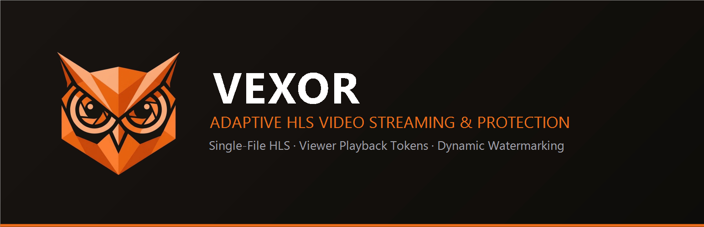

<p align="center">
  <a href="https://vexor-video.vercel.app/"></a>
</p>

<p align="center">
  
</p>

<h1 align="center">VEXOR Video for WordPress</h1>

<p align="center">Secure, adaptive video playback for WordPress sites and LMS courses.</p>

<p align="center"><a href="https://vexor-video.vercel.app/">VEXOR Platform</a> · <a href="https://vexor-video.vercel.app/developers">Developer Guide</a> · <a href="https://github.com/eyob13-coder/Vexor-">GitHub</a></p>

Embed Vexor-hosted video in WordPress posts, pages, and LMS lessons. The plugin uses your Vexor API key on the WordPress server to request short-lived playback access; the key is never rendered into the page.

## What it does

- Plays token-authorized adaptive HLS with the Vexor player.
- Requests viewer-specific playback tokens through WordPress AJAX, so page-cache entries do not contain a playback token.
- Refreshes playback authorization when a token expires during a long viewing session.
- Supports an optional visible watermark and context-menu/drag deterrents. Neither prevents screen recording or replaces access control.
- Shows your Vexor assets and ready thumbnails in wp-admin, with a shortcode copy action.
- Verifies Vexor webhook signatures and exposes WordPress actions for application-specific automation.

The plugin does not include its own transcoder, billing system, DRM, or LMS enrollment rules. Configure your LMS's own lesson access and, when needed, use the `vexor_can_view_asset` filter to apply your site's authorization policy before a playback token is issued.

## Requirements

- WordPress 5.8 or later
- PHP 7.4 or later
- A Vexor account and API key

## Install

1. In WordPress, open **Plugins → Add New → Upload Plugin**.
2. Upload the `vexor-video.zip` archive from this package, install it, and activate **Vexor Video Platform**.
3. Open **Vexor Video → Settings** and enter your API key and deployed VEXOR API origin. The public site is `https://vexor-video.vercel.app/`; the API has its own origin.
4. Select **Test Connection** to check the server-side connection.
5. Open **Vexor Video → All Videos**, copy an asset shortcode, and add it to a post, page, or lesson.

```text
[vexor_player id="ea56fdde-ad35-44f6-ad9a-8cd01c4f10d1"]
```

You can also add the shortcode directly. The `id` must be a Vexor asset UUID.

## Shortcode options

| Attribute | Default | Description |
| --- | --- | --- |
| `id` | Required | Vexor asset UUID. `asset_id` is also accepted for compatibility. |
| `poster` | Vexor thumbnail | Optional poster image URL. |
| `watermark` | `default` | Shows the configured visible label for signed-in WordPress users; use `false` to disable, or pass custom text. |
| `protect` | Site setting | Enables context-menu and drag deterrents. It does not prevent capture. |
| `autoplay` | `false` | Request autoplay. Browser policy may require `muted="true"`. |
| `muted` | `false` | Start muted. |
| `class` | Empty | Additional CSS classes for the player container. |

Example:

```text
[vexor_player id="ea56fdde-ad35-44f6-ad9a-8cd01c4f10d1" autoplay="true" muted="true"]
```

## LMS access control

The plugin cannot infer whether a visitor is allowed to watch an asset. Playback is denied unless your site explicitly allows it through `vexor_can_view_asset`; a WordPress AJAX nonce alone does not grant access. Connect the filter to your LMS or membership rules:

```php
add_filter('vexor_can_view_asset', function ($allowed, $asset_id, $user_id) {
    // Return true only when your LMS or membership plugin authorizes this viewer.
    return my_course_policy_allows_video($user_id, $asset_id);
}, 10, 3);
```

For intentionally public videos, add a policy that explicitly allows public playback:

```php
add_filter('vexor_can_view_asset', function ($allowed, $asset_id, $user_id) {
    return true; // Use only when every visitor may view every embedded Vexor asset.
}, 10, 3);
```

The filter runs on the server before Vexor issues a playback token. Implement the policy with the API provided by the LMS or membership plugin installed on your site.

## Webhooks

Set the webhook endpoint in your Vexor console to:

```text
https://YOUR_SITE.example/wp-json/vexor/v1/webhook
```

Copy the webhook secret into **Vexor Video → Settings**. The plugin verifies the HMAC against the exact request body before it calls WordPress hooks. It exposes both an event-specific hook and a generic hook:

```php
add_action('vexor_webhook_video_asset_ready', function ($data, $event) {
    $asset_id = $event['asset_id'] ?? null;
    // Apply idempotent application logic using $event['event_id'] as its key.
}, 10, 2);

add_action('vexor_webhook_received', function ($type, $data, $event) {
    // Handle other accepted video.* events when needed.
}, 10, 3);
```

Webhook handlers should be idempotent. Vexor can retry delivery, and the event ID is available as a stable deduplication key.

## Privacy and playback security

The API key and webhook secret are stored as WordPress options and are not printed into frontend markup. Playback authorization is requested server-side for each viewer, and the returned short-lived playback token is sent to that viewer's browser. Keep WordPress, plugins, and backups protected. Use HTTPS for the WordPress site and Vexor API in production.

Visible watermarks and browser interaction deterrents are not DRM. A viewer may still record or redistribute video that can be played on their device. Enforce authorization in your application and LMS, and avoid putting sensitive personal data in watermarks.

## Open Source & Build Instructions

In accordance with WordPress.org Plugin Directory Guidelines, all source code is open, public, and human-readable:

- **Public Repository**: [https://github.com/eyob13-coder/Vexor-/tree/main/packages/player](https://github.com/eyob13-coder/Vexor-/tree/main/packages/player)
- **Bundled Source Files**: Original uncompiled source code is inside [`src/`](src/) and unminified bundle is at [`assets/js/vexor-player.js`](assets/js/vexor-player.js).
- **Third-Party Libraries**: [`hls.js`](https://github.com/video-dev/hls.js) v1.7.4 (Apache-2.0 License). See `assets/licenses/THIRD-PARTY-NOTICES.txt`.
- **Build Steps**:
  ```bash
  git clone https://github.com/eyob13-coder/Vexor-.git
  cd Vexor-/packages/player
  npm install
  npm run build
  ```

## Development source

The plugin source is in `packages/vexor-wordpress`. The Python SDK and React player source are in `packages/vexor-python` and `packages/player`.

## Support Vexor

If Vexor helps your product, you can support its continued development on [Buy Me a Coffee](https://buymeacoffee.com/eyob_dev).

## License

GPL-2.0-or-later. See [LICENSE](LICENSE).
